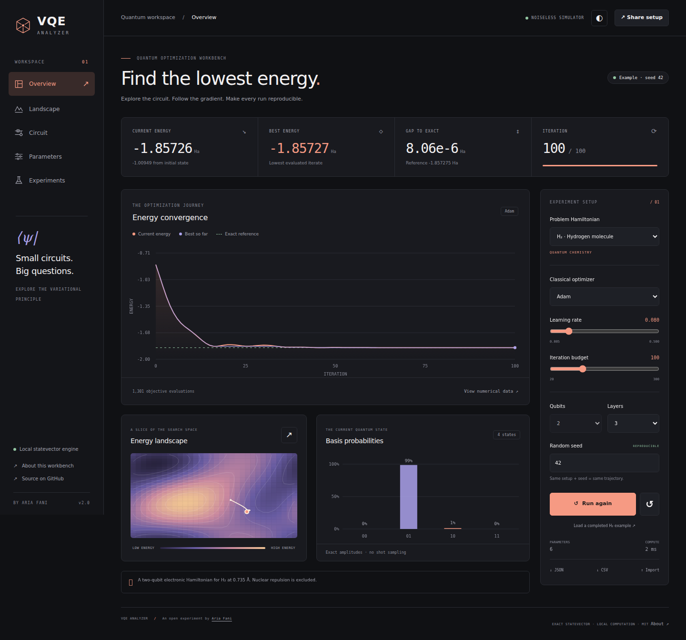

# VQE Analyzer

[](https://github.com/aixaria0/vqe-analyzer/actions/workflows/test.yml)
[](https://github.com/aixaria0/vqe-analyzer/actions/workflows/lint.yml)
[](LICENSE)

**Small circuits. Big questions.**

An open quantum optimization workbench by **Aria Fani**. My first repository: inspect the circuit, follow the energy, and let a stochastic search retain what it learns.

[Open the workbench](https://aixaria0.github.io/vqe-analyzer/)



## What runs here

The browser evaluates `E(θ) = ⟨ψ(θ)|H|ψ(θ)⟩` from an actual statevector. Each ansatz layer applies one RY rotation per qubit, then a sequential nearest-neighbor CX chain. All amplitudes stay real for these circuits, so the engine uses a Float64 buffer.

There is no build step, backend, CDN, telemetry, account, or hardware connection. HTML, CSS and vanilla JavaScript are the complete application. Development dependencies are only used for linting and tests.

| Problem | Objective | Size |
| --- | --- | --- |
| H₂ molecule | Electronic Hamiltonian at 0.735 Å; nuclear repulsion excluded | 2 qubits |
| Ising chain | Open chain, `−Σ Zi Zi+1 − 0.7 Σ Xi` | 2–6 qubits |
| MaxCut ring | Negative expected cut of an unweighted ring; one edge for 2 vertices | 2–6 qubits |
| Portfolio | Toy binary selection: risk − return + budget penalty | 2–6 qubits |

The full Hamiltonian gives the exact reference through small-matrix Jacobi diagonalization, or direct minimization for diagonal objectives. The ansatz may not reach that reference. MaxCut uses the same RY/CX ansatz as the other experiments; it is not a QAOA implementation.

## Live evolution is the default

Opening the workbench starts a fresh stochastic search. Each cycle uses a new seed and real circuit evaluations. The search retains the best parameter vector, explores Gaussian mutations around it, and periodically makes a global random restart. Improvement reduces the mutation radius; stagnation expands it. The iteration budget is **steps per cycle**, not the lifetime of the search. It continues until paused.

Best parameters and search state survive page reloads in browser storage, separately for each Hamiltonian, qubit count and layer count. Stored scores are recomputed from their circuit before use. This is optimization memory and adaptive search, not a claim that a language model or general intelligence is training itself. Current candidates can become worse while the retained best stays at least as good.

Two search modes are available:

| Mode | Initialization | What happens at the budget |
| --- | --- | --- |
| Live evolution (default) | Mutate the learned best or restart randomly | Start another cycle; retain the best |
| Fresh random run | A new seed and new initial angles | Stop; Run again generates another start |

**New random start** keeps learned best parameters. **Clear learned memory** discards that circuit's stored best. The landscape can follow the current angles or freeze its conditioning angles at initialization. Background tabs pause computation and resume when visible, preserving progress.

JSON exports include the current cycle's initial angles and, for live searches, a validated learning checkpoint and recent cross-cycle trace. Import reevaluates saved circuit parameters and restores the best as a starting point for fresh live exploration. CSV exports the recent learning trace in live mode. Long traces are capped at 1,200 rows; the notebook keeps best parameters to continue exploring later. Share links carry circuit settings; every visit starts fresh exploration.

## The workspace

- **Overview:** actual energy convergence, best iterate, exact gap and basis probabilities. Above eight states, the probability chart shows the eight most likely states.
- **Landscape:** a sampled two-angle slice of the real objective, with other angles following the current state or fixed at initialization. The path is a projection of the optimization trajectory. It is not a full-dimensional landscape or a barren-plateau detector.
- **Circuit:** the generated gate diagram, circuit dimensions, amplitude-buffer memory and Hamiltonian.
- **Parameters:** angle histories and exact parameter-shift gradients at the current state.
- **Experiments:** same-seed comparisons of Adam, gradient descent and SPSA, plus a notebook of up to eight saved runs.

Run, pause, resume or reset. Changing the setup resets the experiment and cancels pending work. Export the numerical trace as CSV or a complete run as JSON. Imports and notebook restores recompute circuit energies before continuing stochastic search. Share links encode circuit settings. Dark and light themes, keyboard navigation and mobile controls are included.

Notebook and theme preferences are stored in the browser when storage is available. Export JSON for a portable copy; clearing browser storage clears the notebook.

## Start

Open `index.html` directly, or serve the directory:

```bash
git clone https://github.com/aixaria0/vqe-analyzer.git
cd vqe-analyzer
python3 -m http.server 8000
```

Visit `http://localhost:8000`. If Node 22+ is available, `npm run serve` starts a server that exposes only the public app assets; no installation is needed for that command.

The H₂ example uses a fresh random initialization on each click. Exact diagonalization supplies the electronic ground-state reference of approximately **−1.857275030 Ha**; the variational result depends on the run.

**Keyboard:** Space runs or pauses; R resets when focus is outside a control. Arrow keys, Home and End navigate the analysis tabs.

## Independent Python reference

The NumPy solver implements the same H₂ circuit and all three optimizers independently. Its random generator matches the browser's initial angles. It requires no Qiskit installation or cloud credentials.

```bash
python3 -m pip install -r requirements.txt
python3 vqe_solver.py --seed 42 --iterations 100 --json h2-run.json
python3 vqe_solver.py --optimizer SPSA
```

The exported JSON can be imported into the browser and recomputed. `VQE-SOLVER.py` remains as a compatibility entry point. Hardware execution is not implemented.

## Verify

Node **22 or newer** is required for development tooling.

```bash
npm ci
npm run lint
npm test
npx playwright install chromium
npm run test:e2e
```

For the independent numerical check:

```bash
python3 -m pip install -r requirements.txt
npm run test:python
VQE_PYTHON_PARITY=1 npm test
```

Tests cover analytic Bell states and bit order, known spectra and variational bounds, gradients against finite differences, deterministic replay, fresh random starts, retained elite parameters, adaptive mutations and global restarts, memory isolation, real evaluation counts, configuration validation, and NumPy/JavaScript parity. Browser tests cover desktop, tablet and mobile layouts; run lifecycle; all views; imports and exports; multi-cycle live search and retained memory after reload; shared links; notebook learning restore; blocked storage; direct file loading; and automated WCAG A/AA checks in both themes. Automated accessibility checks supplement manual review.

GitHub Actions runs ESLint, unit tests on Node 22 and 24, Python parity, browser tests and CodeQL for JavaScript, Python and workflow files. Browser reports include screenshots and failure traces.

## Repository map

```text
index.html / style.css   Interface and responsive themes
engine.js               Statevector, Hamiltonians, gradients and optimizers
evolution.js            Stochastic cycles, retained elite and adaptive mutations
charts.js               Canvas plots and contour slices
app.js                  Experiment lifecycle, UI, import/export and notebook
vqe_solver.py           Independent NumPy H₂ reference
tests/                  Numerical, Python and browser regression tests
scripts/serve.cjs        Local static asset server
```

## Changes from v1

The old interface interpolated toward predefined costs, moved angles randomly and displayed static performance scores. V2 evaluates the circuit directly. Placeholder QML, adaptive-growth and “Quantum Gem” presets were retired until they have implemented objectives. The optimizer labelled COBYLA did not implement COBYLA; the workbench now provides actual Adam, gradient descent and SPSA. Static noise and success-rate claims were removed. Chart.js is no longer required.

This is a noiseless educational simulator with a stochastic adaptive optimizer, limited to small real-amplitude circuits. It does not model hardware noise, demonstrate a quantum advantage, validate industrial portfolio strategies, or prove global convergence.

## Reading

- Peruzzo et al., [A variational eigenvalue solver on a quantum processor](https://arxiv.org/abs/1304.3061).
- Schuld et al., [Evaluating analytic gradients on quantum hardware](https://arxiv.org/abs/1811.11184).

## Support independent development

Follow [Aria Fani on LinkedIn](https://www.linkedin.com/in/ariafani), open an issue, contribute an experiment, or buy me a tea ☕.

- **USDT/USDC (TRC20):** `TKGv7Jap7hE5DVtaDYBQWqXQjcdW61NRT6`
- **ETH/USDT (ERC20):** `0x774D95E2F263c56bE908E878B866D675df9282A4`
- **TON:** `UQAdHM0Sd008XSW6B4xPfd2uU07zZratOVrerD6subpxgyNK`

Commercial integration inquiries: open an issue or connect on LinkedIn.

MIT © Aria Fani. See [LICENSE](LICENSE) and [CONTRIBUTING.md](CONTRIBUTING.md).
